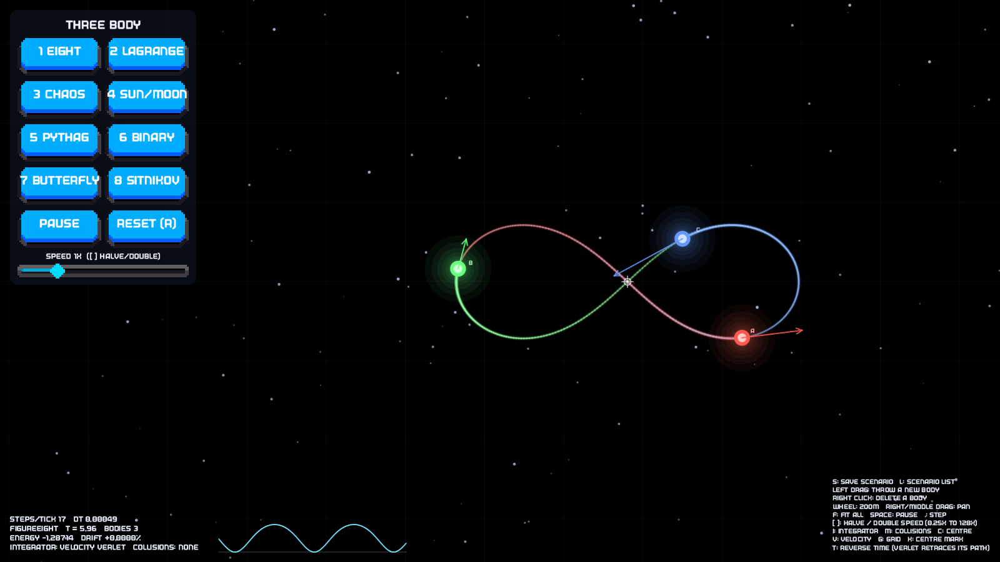

# A first game: the three body problem

`samples/ThreeBody` is a small but complete game on the engine's NuGet packages, three or more bodies pulling on each other under gravity, drawn with glowing trails, with presets, a HUD, mouse controls and scenarios saved to disk. It's the example to read after [Getting started](getting-started.md), the pieces of the guide put together into one program, and it needs nothing of this repository to build, its project only references `bogzxo.Horizon.Engine`, `bogzxo.Horizon.Platform.Desktop` and `bogzxo.Horizon.UI`.



```
cd samples/ThreeBody
dotnet run
```

It was made by two agents working at once over [Hex Link](https://github.com/bogzxo/hex), one on Windows writing the simulation and one on a Mac writing the drawing and the HUD, which is why its folders split the way they do.

## What's where

| File | What it does |
|---|---|
| `Program.cs` | The same few lines as every game, the desktop platform installed, a 1600 by 900 window, `engine.Run<MainScene>()` |
| `MainScene.cs` | The scene, a `Scene2D`, which wires the simulation, the drawing, the HUD and the input together |
| `Simulation/NBodySystem.cs` | The physics, plain C# with no engine types in it, velocity Verlet or Yoshida's fourth order integrator, collisions, energy |
| `Simulation/Presets.cs` | The starting positions and velocities, the figure-eight, Lagrange's triangle, the Pythagorean problem and the rest |
| `Simulation/Scenario.cs` | Saving the bodies to JSON and loading them back |
| `Rendering/BodyRenderer.cs` | The bodies, their trails, the stars and the grid, all drawn through `Shapes` |
| `Rendering/CameraFit.cs` | A camera that keeps every body in view, smoothly |
| `Rendering/Effects.cs` | The flash and the ring where two bodies collide |
| `UI/Hud.cs`, `UI/NameLabels.cs` | The panel of presets and speed, the readouts, the inspector, the labels beside the bodies |

## Each thread doing its own part

The simulation is stepped in `UpdatePhysics`, on the simulation thread at a fixed rate, and nothing else touches it there, so a button pressed in the HUD doesn't change the simulation from under a step. The HUD's handlers run on the same thread, but they only leave a note, and the step takes the notes in before it runs.

```csharp
public override void UpdatePhysics(float dt)
{
    base.UpdatePhysics(dt);
    while (simActions.TryDequeue(out var action)) action();
    sim.Update(dt);
}
```

Drawing is one `Shapes.Describe` set up in `Initialize`, called at the end of every tick with the list cleared, so whatever it draws is the simulation as it is now, and the frames in between are blended by the engine.

```csharp
Shapes.Describe = shapes =>
{
    var viewport = Engine.WindowManager.ViewportSize;
    var centre = new Vector2(Camera.Position.X, Camera.Position.Y);
    float span = Camera.ViewSize.Y;
    bodies.Describe(shapes, sim, centre, span, viewport);
    effects.Describe(shapes, span / MathF.Max(1.0f, viewport.Y));
};
```

## Accurate at any speed

The simulation never takes a bigger step to go faster. At 1x a tick is a handful of steps of at most `BaseStep` (0.0005 time units), at 128x it's a couple of thousand, and a close encounter shrinks the step further. A cap on the steps of one tick keeps a frame from stalling, and when the cap is reached the time left over is dropped and the HUD says the speed is limited by the CPU, rather than the orbits quietly going wrong.

```csharp
_carry += Math.Min(dtSeconds, 0.1) * _timeScale;
while (_carry > 1e-9 && steps < MaxStepsPerUpdate)
{
    double dt = Math.Min(Math.Min(BaseStep * Math.Clamp(Math.Pow(MinSeparation() / 0.3, 1.5), 0.0005, 1.0), _carry), BaseStep);
    Step(dt);
    _carry -= dt;
    steps++;
}
SpeedLimited = _carry > 1e-9;
```

The figure-eight keeps its energy to about one part in ten million over twenty time units at 1x, 16x and 128x alike, and the readout in the bottom left corner shows the drift as it runs.

## Playing it

| Input | What it does |
|---|---|
| 1 to 8, or the buttons | the presets |
| Space, R | pause, reset |
| `[` `]` | halve and double the speed, 0.25x to 128x |
| Left drag | throw in a new body, the arrow is the velocity it gets |
| Click a body | inspect it, Escape lets go |
| Right click | delete a body |
| Wheel, right or middle drag | zoom at the pointer and pan, F gives the camera back to the fit |
| `.` | one step while paused |
| T | reverse time, Verlet retraces its path |
| I, M, C | integrator, collisions, back to the centre of mass frame |
| V, G, K, N | velocity arrows, grid, centre of mass, names |
| S, L | save a scenario, load one from the list |

## Where to go from it

Every part of it is covered by a page of this guide: the scene and its threads in [Threads, entities and components](threads-and-entities.md), `Shapes` and input in [Drawing, input and the world](drawing-and-input.md), the HUD in [UI and HIDL](ui-and-hidl.md). A game of your own starts the same way, `Program.cs` as it is, a scene, and the simulation of whatever your game is kept apart from the drawing of it.
