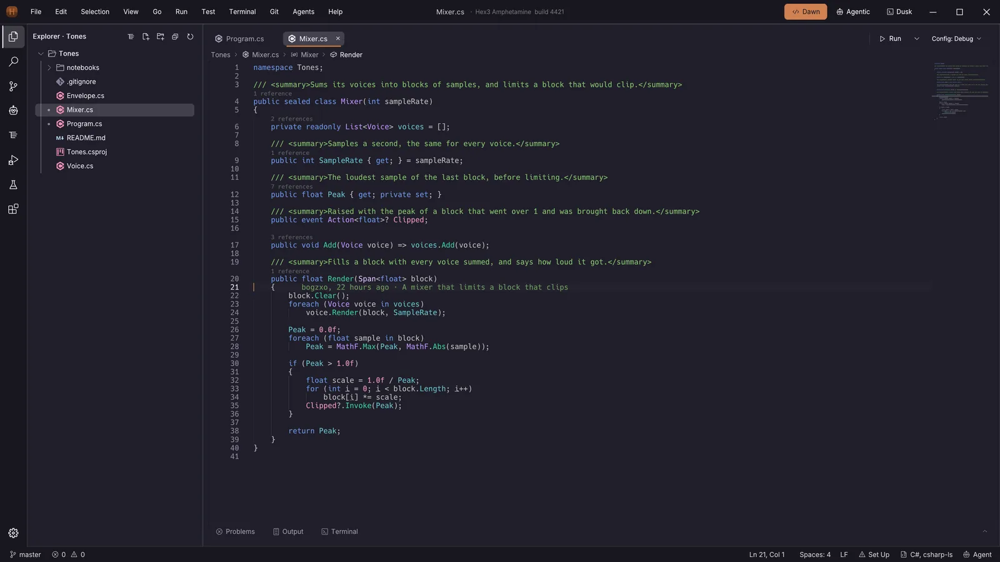
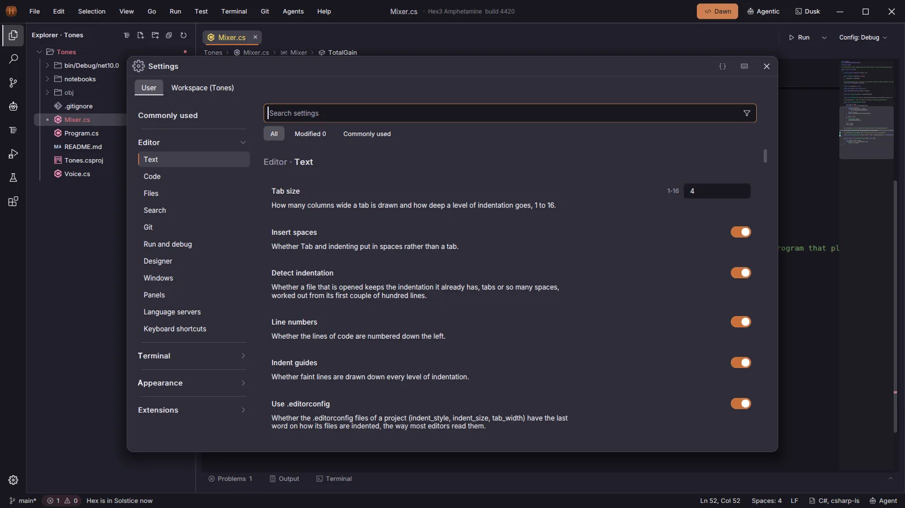
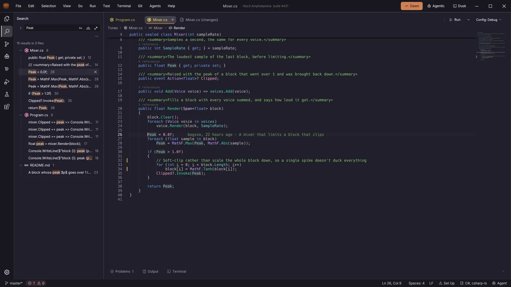
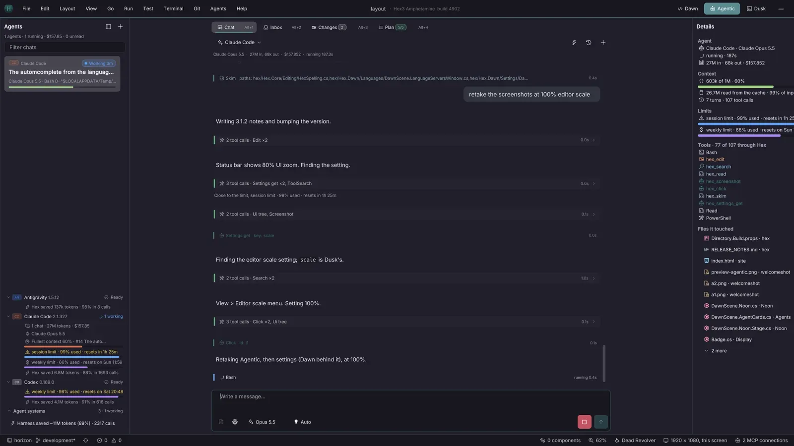
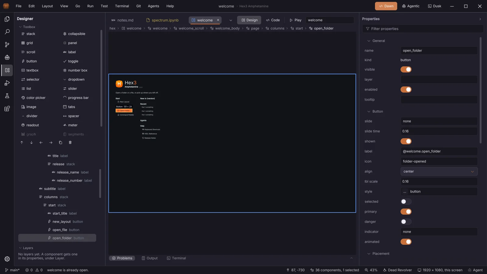

# Desktop applications

Horizon is a game engine, and the same engine builds high performance desktop GUI applications, the proof being [Hex](https://github.com/bogzxo/hex), a code editor, a terminal and a place for agents in one program, drawn entirely by Horizon and its UI, with no browser, no DOM and no JavaScript runtime anywhere underneath it.

Hex is C# compiled ahead of time with NativeAOT and drawn through Vulkan by Horizon, with MoltenVK bridging that to Metal on macOS, and the numbers it publishes for its 3.3.0 release, measured on an ordinary Windows 11 machine with a Ryzen 5 5600X and an RTX 3060, are what an application on the engine can expect to start from.

| Hex 3.3.0, measured | |
|---|---:|
| Process start to the editor's first frame, median | 450 ms |
| Woken from its background sleep to the window on screen, median | 56 ms |
| CPU at rest, of one logical core | 2.09% |
| Memory with the Horizon repository open (995 C# files), every process summed | 473 MiB |

The method, every launch's numbers and how to reproduce them are in [Hex's benchmarks](https://github.com/bogzxo/hex/blob/master/docs/benchmarks.md). The rest of this page is what an application does differently from a game, all of it in the engine and none of it Hex's alone.



*Hex's editor, every pixel of it drawn by Horizon and UIX, a frameless window with its own title bar and menus, a `TreeView` explorer and the `CodeEditor`, with the colours and reference counts coming from csharp-ls. Taken from Hex 3.3.0.*

| | |
|---|---|
|  |  |
| A `SettingsPage` in a `WindowPanel` over the editor, sections on the left, search over the top | Search across the workspace, its results in a `TreeView` grouped by file |
|  |  |
| Agentic, chats side by side, each card a part of its own | The designer, laying out a `.hor` file, see [UI and HIDL](ui-and-hidl.md#designing-layouts-in-hex) |

## Running as an application

A game draws every frame the screen shows and ticks at its rate whatever is going on, an application wants the opposite, to cost next to nothing while nobody is using it, and saying so is one line of the window's configuration.

```csharp
using Horizon.Core;
using Horizon.Engine;

Directory.SetCurrentDirectory(AppContext.BaseDirectory);
Horizon.Platform.Desktop.DesktopPlatform.Install();

using var engine = new GameEngine(WindowManagerConfiguration.Default1600x900 with
{
    WindowTitle = "Notes",
    Mode = RunMode.Application,     // draw on change, slow when idle, wait for events
    CustomFrame = true,             // no system frame, the UI draws its own title bar
    ScaleToDisplay = true,          // 150% on a 4K screen, the way every other program is
    AppId = "notes"                 // the .desktop file Linux finds the icon by
});
engine.Run<NotesScene>();
```

`RunMode.Application` switches on every one of `ApplicationBehaviour`'s ways of saving work, and `Behaviour` picks them one at a time for a tool that wants one off, or a game that wants one on.

| Behaviour | What it does |
|---|---|
| `DrawOnChange` | a frame is drawn only when something wants one, a UI that painted something new, the window resized, the mouse moving over a cursor of the engine's, and otherwise the drawing thread sleeps, with a heartbeat frame a second so nothing is left stale for long |
| `SlowWhenIdle` | the simulation drops to a few ticks a second once there has been no input and no UI change for a moment, each of those ticks as long as the time that went by, and input wakes it at once |
| `WaitForEvents` | the window's thread waits for the system to have something to say, rather than asking it a thousand times a second |

The UI says when it changed by itself, so a caret's blink, a spinner that is turning or a list that scrolled keeps the frames coming for exactly as long as it moves, and nothing more.

## Work off the simulation thread

An application that has gone quiet ticks a few times a second, so a result that finishes somewhere else, a search, a file read, a language server's answer, would wait for the next slow tick to be taken in. `Wake` asks for a tick at once, and is safe from any thread.

```csharp
private readonly ConcurrentQueue<string> found = new();

private void Search(string text) => Task.Run(() =>
{
    foreach (string line in SearchFiles(text))
        found.Enqueue(line);

    Engine.WindowManager.Wake();        // take it in now, not on the next idle tick
});

public override void UpdateState(float dt)
{
    base.UpdateState(dt);

    // Simulation thread, where the UI lives, so the results go straight into it
    while (found.TryDequeue(out var line))
        results.Items.Add(new UITreeItem(line, "search"));
    results.Refresh();
}
```

The rule is the one from [Threads, entities and components](threads-and-entities.md), the UI is read and changed on the simulation thread, anything else hands its results over, through a queue drained in `UpdateState` like this one, and wakes the window. `RequestTickIn` asks for a tick a set time from now without asking for frames, for a timed change such as a caret's next blink, and `RequestFrames` asks for frames for a moment from any thread.

## A window of its own

With `CustomFrame` the window has no title bar or border of the system's, and the UI draws its own, a `TitleBar` with the window's icon, title and minimise, maximise and close at the right end, dragged to move the window and double clicked to maximise it, with whatever a layout puts in it in between, the way VS Code puts its menus in its title bar.

```js
#define layout

let bar = compositor.title_bar({ title: "Notes", icon: "notebook" });
let menu = compositor.menu_bar({ parent: bar });
```

A layout only says where the menu bar goes, what is in it is the program's, put together in code, with shortcuts shown beside each item, icons, separators, submenus and items that are only enabled or shown some of the time. Alt and a letter opens a menu by its mnemonic, the way Windows does it.

```csharp
compositor.ResizesWindow = true;        // the edges of the frameless window are dragged by this UI

var bar = layout.Get<MenuBar>("menu");
Menu file = bar.AddMenu("File");
file.Add("Open...", OpenPressed, "Ctrl+O", icon: "folder-opened");
file.AddSeparator();
file.Add("Save", Save).IsEnabled = () => document.IsChanged;
Menu recent = file.AddMenu("Open recent");
```

`Maximized` starts the window filling its screen, `StartHidden` makes it and leaves it hidden for a program that starts with the system and shows itself later, and `WindowIcon` names the picture for its corner and the taskbar.

## The parts an application is made of

The controls of [UI and HIDL](ui-and-hidl.md) are all there, and an application gets the ones Hex is built from as well, each a part of Horizon.UI.

| Part | What it is |
|---|---|
| `TreeView` | rows that open and close, an explorer, an outline, search results, painting its rows itself and only the ones in sight, so hundreds of rows cost what the screen shows |
| `CodeEditor` | the editor of Hex, HIDL coloured by its own lexer, completion, diagnostics with squiggles, folding, a minimap and find |
| `MenuBar`, `ContextMenu`, `UIDialog` | menus, right click menus and dialogs, all walkable with the keys |
| `WindowPanel` | a window inside the window, with a title, a close button and a modal mode |
| `SettingsPage` | a page of settings with search, the one Hex's settings are |
| `Graph`, `Readout` | graphs, meters and numbers that update every tick without making garbage |
| `TerminalView` | a real terminal, ConPTY and a VT screen, in Horizon.Terminal |

```csharp
var files = new TreeView { Size = new Vector2(260, 400) };
var src = new UITreeItem("src", "folder") { Expanded = true };
src.Add(new UITreeItem("Program.cs", "file-code", tag: "src/Program.cs"));
files.Items.Add(src);
files.Refresh();

files.OnActivated = item => Open((string)item.Tag!);                     // double click or enter
files.OnItemContextMenu = (item, point) => ShowFileMenu(item, point);
```

A tree's rows are the program's, handed over, changed and refreshed, and a row that `Expandable` says has children it has not made yet gets `OnExpanding` the moment it is opened, which is when a folder is read off the disk.

## Why it stays fast

- **Two loops that never wait on each other.** Drawing has its own thread and the application's logic another, frames are drawn between ticks and blended from the last two, so a slow piece of work in the application never stalls a frame already on its way to the screen.
- **The interface is painted, then compared.** Every tick the UI is laid out and painted into a list of quads, a component that has not changed since the last tick has its quads taken from the last list as they were rather than painted again, and the finished list is held up against what is already on screen, an identical one being dropped before it costs the GPU anything.
- **Text from signed distance fields.** Text stays crisp at any interface size, 125% on a 4K screen included, without a glyph atlas for every size.
- **No garbage in the hot paths.** The performance overlay, the graphs and the readouts are written to make no allocations per tick, and `HORIZON_LOG_ALLOCATIONS=5` logs what every thread allocates by type, so a part that does not keep to it shows up by name.
- **Ahead of time compiled.** A program on the engine publishes with NativeAOT, so there is no JIT warming up behind a splash screen and no runtime to install, `PublishAot` in the project turns it on, the way Hex ships.

The `pacing` example measures how evenly things move from one frame to the next, F3 brings up the performance overlay in any example, and `HORIZON_LOG_LOOPS=5` logs every loop's rate and how long its turns take, which together are how a stall gets found rather than guessed at.
