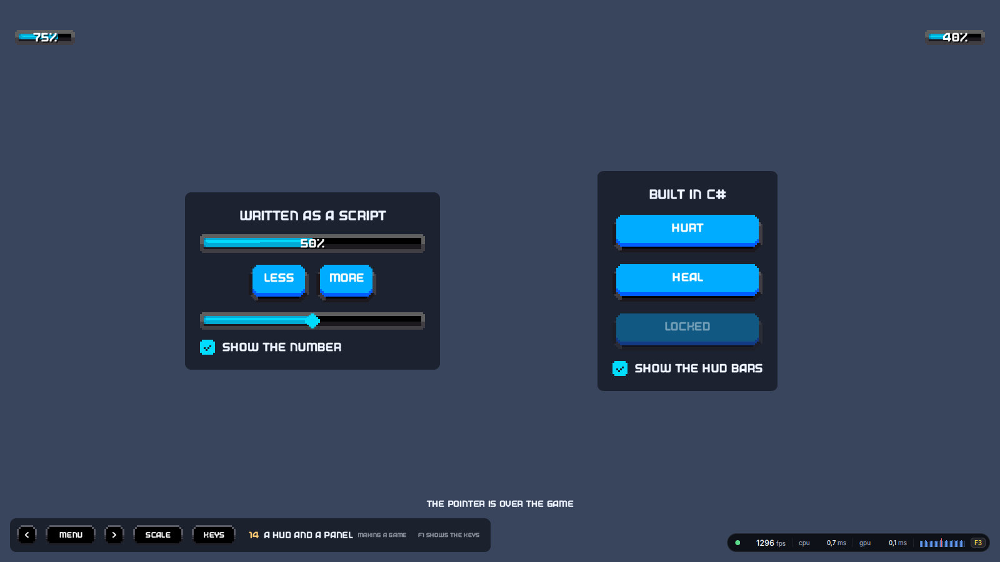
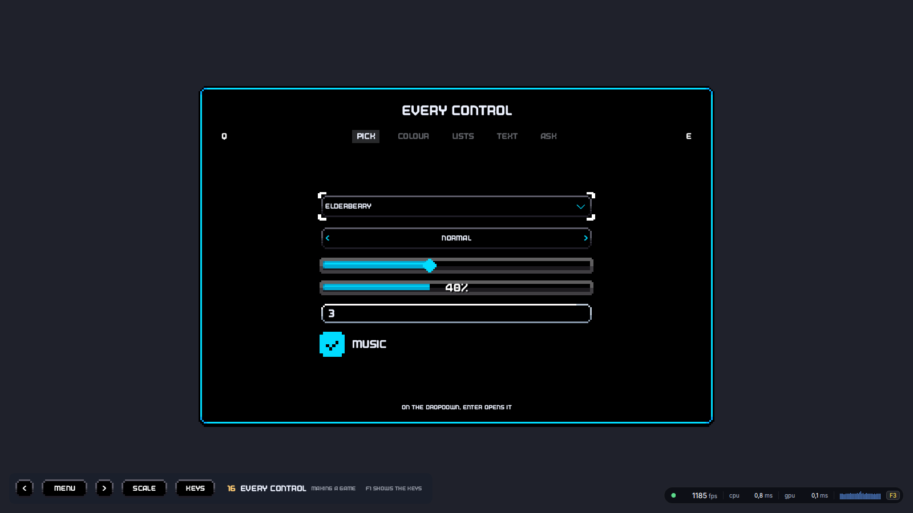
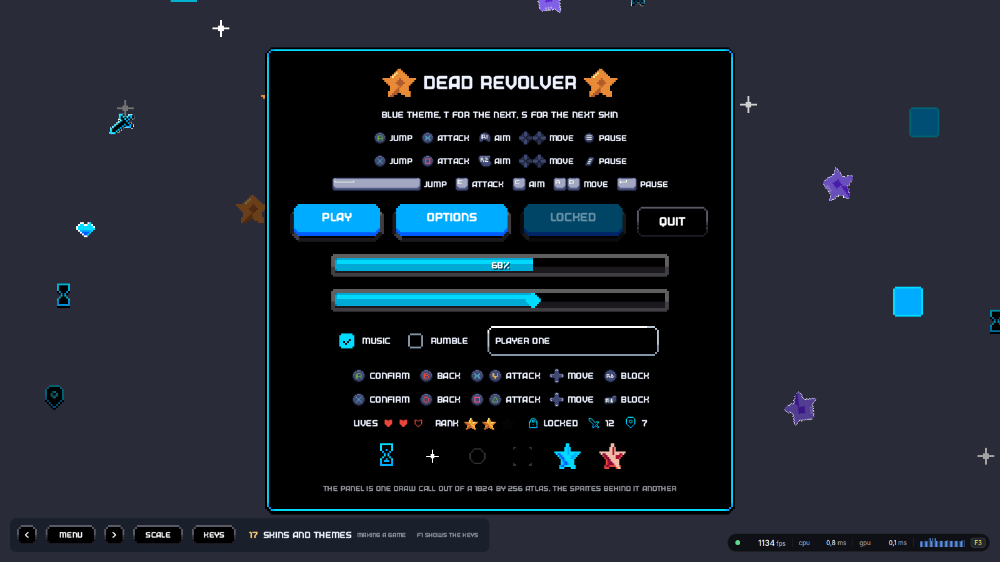
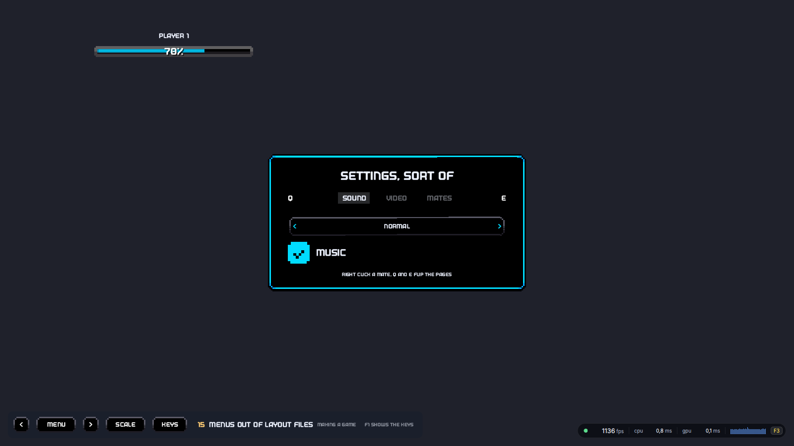
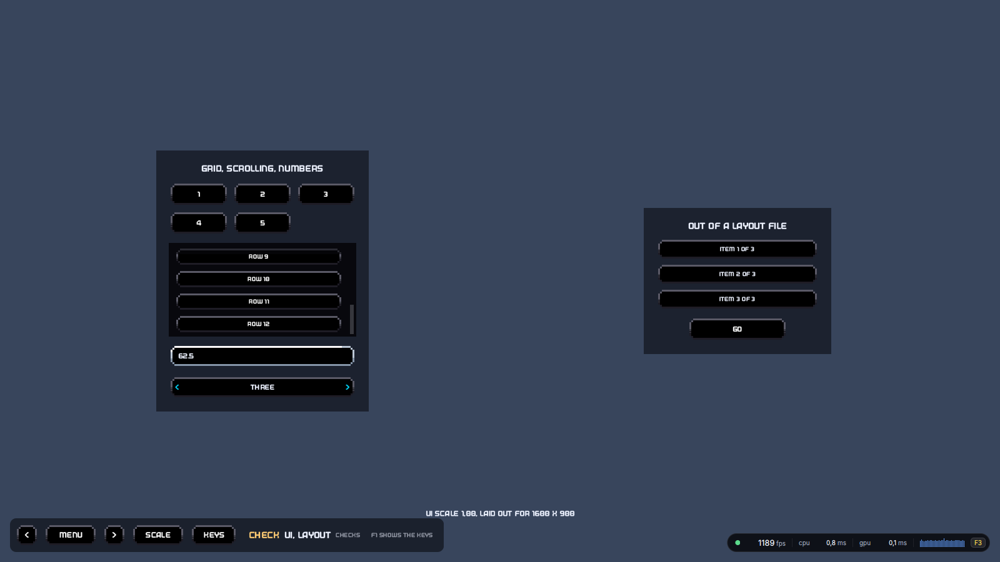
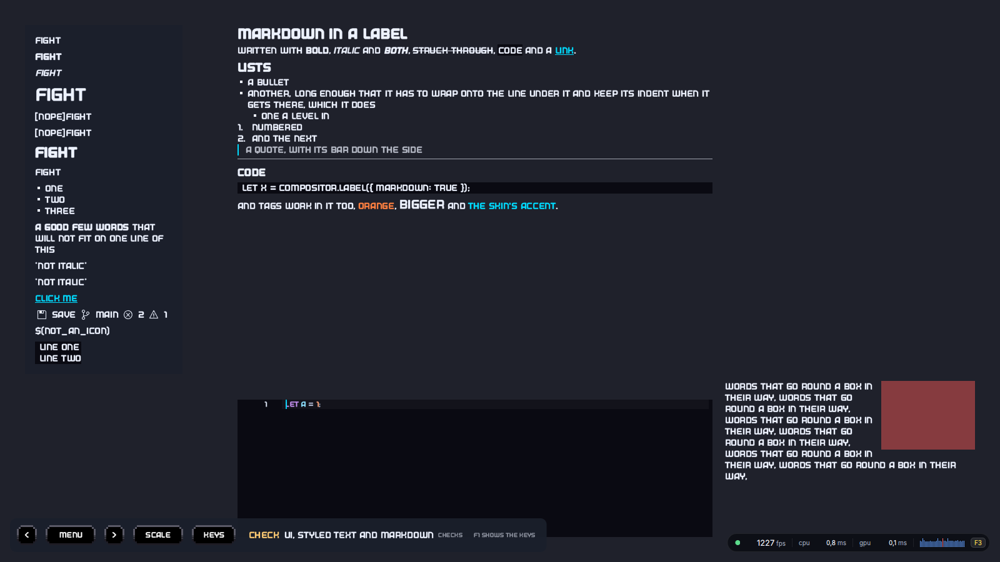
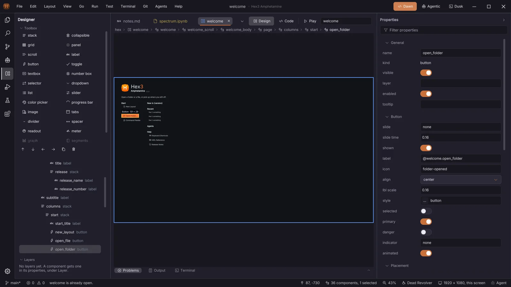

# UI and HIDL

Horizon's UI is UIX, which lives in Horizon.UI, and its layouts are written in HIDL, the engine's scripting language. The same UI that draws a game's HUD draws the whole of the [Hex](https://github.com/bogzxo/hex) editor, its explorer, its code editor and its settings, so everything on this page holds as much for a desktop application as for a game, see [Desktop applications](desktop-applications.md) for the parts that are an application's alone.

The examples for this page, in the order worth reading them, are `ui` (`Examples/Game/UIBasicsExample.cs`), `ui-layouts` (`Examples/Game/UILayoutsExample.cs`), `ui-controls` (`Examples/Game/UIControlsExample.cs`, with its layout `Assets/examples/ui/gallery.hor`), `ui-skin` and `touch-input`. The screenshots on this page are those examples and checks as they run, taken with `HORIZON_SCREENSHOT` in the Dead Revolver skin at 1600 by 900, with the list of keys folded away (F1).

| | |
|---|---|
|  |  |
| `ui`, the same panel as a script and in C#, and a HUD pinned to the corners | `ui-controls`, one of everything, a page at a time |
|  |  |
| `ui-skin`, a pack of art as a skin, icons in text | `ui-layouts`, a settings screen out of a `.hor` file |

The HIDL on this page is shown in `js` code fences. GitHub has no highlighter for HIDL, it only highlights languages Linguist knows, and a language is only added to Linguist once hundreds of public repositories use it, of the ones it does know JavaScript reads HIDL best, its comments, `let`, strings, numbers and calls all come out right and nothing is marked as an error, only `#define` and `func` stay plain. The engine's `.gitattributes` has `.hor` files shown the same way on GitHub, and Hex colours HIDL properly, with the language's own lexer.

## A UI is a component

A `UICompositor` is a UI, added to a scene as a component and drawn through a camera, and what that camera sees is the screen the UI is laid out against. `UICompositor.ForScreen()` makes one the size of the window by itself, and the UI is made of `UIModule`s, pieces that are laid out, moved and scaled as one.

UI components own nothing on the GPU, so the whole lot can be made in the scene's constructor, and the UI is updated on the simulation thread, so a button's handler can touch the game, or the document, directly, with no dispatching back to a UI thread.

```csharp
// Constructor
ui = AddComponent(UICompositor.ForScreen());
var hud = ui.CreateModule();
health = hud.AddComponent(new ProgressBar { Anchor = Origin.TopLeft, Position = new Vector2(24, -48) });

var menu = ui.CreateModule().LoadLayout("Assets/ui/menu.hor");
menu.Get<Button>("play").OnPressed = StartGame;       // simulation thread, like everything about the UI

// UpdateState
if (mouse.WasPressed(MouseButton.Left) && !ui.IsPointerOverUI) Shoot();
```

`Anchor` says which corner or edge of the screen a thing is measured from and `Position` how far from it, Y goes up, so down from the top is a minus, and resizing the window keeps everything in its corner. `IsPointerOverUI` is what a game checks before it treats a click as a shot, and `Focus` is what it checks before it treats a key as a command, a Q typed into a name is a Q.

## The same panel twice

The `ui` example puts the same little panel on screen twice, once built in C# and once written as a script, so the two can be read next to each other.

```csharp
var native = _ui.CreateModule();
native.Position = new Vector2(300, 0);

var panel = native.AddComponent(new StackPanel
{
    Color = PanelColour,
    Radius = 10.0f,
    Padding = new UIEdges(24),
    Spacing = 16,
    Stretch = true      // everything in it as wide as the widest thing in it
});

panel.Add(new Label("Built in C#") { TextScale = 0.45f });
panel.Add(new Button("Hurt") { OnPressed = () => _health.Progress -= 0.25f });
panel.Add(new Button("Heal") { OnPressed = () => _health.Progress += 0.25f });
panel.Add(new Button("Locked") { Enabled = false });

var bars = panel.Add(new ToggleButton("Show the HUD bars", startingState: true));
bars.OnPressed = () => _health.Visible = _stamina.Visible = bars.State;
```

The script is `Assets/examples/ui/scripted_panel.hor`, a layout is a script in which everything it makes is a variable, and the program finds them by those names with `layout.Get<Button>("more")`, what a button does can be said right in the layout, for anything that only touches the UI, or left for the program to say.

```js
#define layout

let panel = compositor.stack({ color: vec(0.1, 0.12, 0.17, 0.92), radius: 10, padding: 24, spacing: 16 });

let heading = compositor.label({ parent: panel, text: "Written as a script", text_scale: 0.45 });
let charge = compositor.progress_bar({ parent: panel, size: vec(360, 30), progress: 0.5 });

let row = compositor.stack({ parent: panel, direction: "horizontal" });
let less = compositor.button({ parent: row, label: "Less", on_pressed: func() { charge.progress = charge.progress - 0.1; } });
let more = compositor.button({ parent: row, label: "More" });
more.on_pressed = func() { charge.progress = charge.progress + 0.1; };

let level = compositor.slider({
    parent: panel, size: vec(360, 28), value: 0.5,
    on_changed: func(value) { charge.progress = value; }
});
```

A module loaded from a layout is still a module, so it moves and scales as one, and a scaled module is still pressed where it is drawn.

## A screen out of a file, the code only wiring it

The pattern that scales is the one `ui-controls` uses, the layout says what there is and where it sits, and the C# says what each thing does, which for most controls is a line. This is the top of its layout, trimmed.

```js
#define layout

compositor.design({ size: vec(1600, 900), fit: "contain" });

let panel = compositor.stack({ background: "panel", padding: vec(40, 28), spacing: 16, intro: "pop", intro_time: 0.3 });
let tabs = compositor.tabs({ parent: panel, tabs: ["Pick", "Colour", "Lists", "Text", "Ask"], text_scale: 0.3, prev_hint: "Q", next_hint: "E" });

let pick = compositor.stack({ parent: tabs, spacing: 12 });
let fruit = compositor.dropdown({ parent: pick, size: vec(480, 44), max_rows: 5, options: ["apple", "banana", "cherry", "damson"], value: "cherry" });
let difficulty = compositor.selector({ parent: pick, size: vec(480, 44), options: ["Easy", "Normal", "Hard"], value: "Normal" });
let volume = compositor.slider({ parent: pick, size: vec(480, 28), min: 0, max: 100, step: 5, value: 40 });
let volume_bar = compositor.progress_bar({ parent: pick, size: vec(480, 26), progress: 0.4 });
let lives = compositor.number_box({ parent: pick, size: vec(480, 40), value: 3 });
let music = compositor.toggle({ parent: pick, label: "Music", size: vec(480, 44), state: true });

let text = compositor.stack({ parent: tabs, spacing: 12 });
let player_name = compositor.textbox({ parent: text, text: "Dave", size: vec(620, 44), max_length: 24 });
let clan = compositor.textbox({ parent: text, placeholder: "clan, tab gets you here", size: vec(620, 44), max_length: 24 });

let status = compositor.label({ parent: panel, text: "", text_scale: 0.22 });
```

Every child of `tabs` is a page, `intro` gives the panel an entrance, and `compositor.design` lays the whole screen out on 1600 by 900 and scales it to whatever it is shown on, `"contain"` keeping its shape in the middle so an ultrawide gets room either side rather than a stretched menu. The C# then wires it, every handler is handed the new value on the simulation thread.

```csharp
_layout = _module.LoadLayout("Assets/examples/ui/gallery.hor");
_status = _layout.Get<Label>("status");

_layout.Get<Dropdown>("fruit").OnChanged = fruit => Say($"picked {fruit}");
_layout.Get<Selector>("difficulty").OnChanged = level => Say($"difficulty, {level.ToLowerInvariant()}");

var bar = _layout.Get<ProgressBar>("volume_bar");
var volume = _layout.Get<Slider>("volume");
volume.OnChanged = value =>
{
    bar.Progress = volume.Progress;                   // the slider runs Min to Max in its own steps, the bar wants 0 to 1
    Say($"volume {value:0} of {volume.Max:0}");
};

_layout.Get<NumberBox>("lives").OnValueChanged = lives => Say($"{lives:0.##} lives");
_layout.Get<TextBox>("player_name").OnSubmitted = text => Say($"hello, {text}");
```

## Lists that grow

A list box takes its items in the layout, `compositor.list({ items: [...], rows: 6 })`, and says what is looked at and what is picked separately, so a program can preview on one and commit on the other.

```csharp
var stage = _layout.Get<ListBox>("stage");
stage.OnChanged = name => Say($"looking at {name}");
stage.OnActivated = name => Say($"{name} it is");
```

Rows that are more than a line of text come out of a template, a container in the layout names the file its items are made from, `compositor.stack({ parent: scroll, template: "gallery_row.hor" })`, and the program says how many and fills each one in, every item being a little layout of its own.

```csharp
var rows = _layout.Populate("rows", 14);
for (int i = 0; i < rows.Count; i++)
{
    int number = i + 1;
    var row = rows[i].Get<Button>("row");
    row.Label = $"row {number} of 14";
    row.OnPressed = () => Say($"row {number}");
}
```



*`check-ui-layout`, a grid, a scroll panel filled from a template and a number box on the left, and items out of a layout file on the right, each pressed and read back by the check itself.*

For a list that keeps changing, `UILayout.Bind` fills a container from the list and keeps it filled, only what is new gets made and makes an entrance, the rest is kept and filled in again, `ui-layouts` binds a list of mates that grows and shrinks with + and -. For hundreds of rows, the explorer of an editor or a list of search results, a `TreeView` paints its rows itself and only the ones in sight, rather than a component for every row, see [Desktop applications](desktop-applications.md).

## Dialogs, menus and tooltips

What comes up over everything else is a line or two each, a dialog takes the keys and the pointer until it is answered and escape is its last choice, a right click hands over where it happened, which is where its menu wants to come up, and anything with a `tooltip` in its layout gets one when the pointer rests on it.

```csharp
_layout.Get<Button>("question").OnPressed = () => UIDialog.Show(_module, "Well?",
    "A dialog sits over everything else in its module. Nothing behind it can be clicked or walked to until one of these is picked.",
    new DialogChoice("Fair enough", () => Say("fair enough")),
    new DialogChoice("Never mind", () => Say("never mind, then")));

var menu = _layout.Get<Button>("menu");
menu.OnContextMenu = point =>
{
    var options = new Menu("Right click");
    options.Add("Do a thing", () => Say("did a thing"));
    options.Add("Do another", () => Say("did another"));
    options.AddSeparator();
    options.Add("Do nothing", () => Say("nothing happened, as asked"));
    ContextMenu.Show(_module, point, options);
};
```

## Text, styled and in markdown

A label styles its text with tags in square brackets, `[b]bold[/b]`, `[i]italic[/i]`, `[color:#ff8040]` with `[/color]` to go back, `[size:1.5]` with `[/size]`, and icons in the middle of a sentence, `[icon:pad_a] to confirm`, drawn from the skin. Told it is markdown it reads headings, lists, quotes, code, rules and links as well, and says when a link is clicked.

```csharp
var notes = module.AddComponent(new Label
{
    Size = new Vector2(620, 0),
    Wrap = true,
    Markdown = true,
    Text = "# Release notes\n- **Faster** launches\n- See [the guide](guide)",
    OnLink = where => OpenGuide(where)
});
```



*`check-ui-text`, the check that drives all of it, tags on the left, markdown in the middle, a code editor under it and wrapped text on the right.*

A label given a width and told to wrap breaks its own lines between words and grows downwards to fit them. Text that holds a name somebody typed goes through `UIRichText.Literal` first, so a name with brackets in it is shown as written rather than read as a tag.

## Without a mouse

Every module has a `UINavigator` that walks from one control to the next by where they are on screen, the arrow keys, enter and escape work by themselves, and a gamepad is the program's to hand over.

```csharp
var nav = module.Navigation;
nav.SelectFirst();                                    // something selected, so the arrow keys have somewhere to start

if (pad.WasPressed(GamepadInput.DPadDown)) nav.Move(0, 1);
if (pad.WasPressed(GamepadInput.DPadRight)) nav.Adjust(1);      // steps a selector, slides a slider
if (pad.WasPressed(GamepadInput.A)) nav.Activate();
```

`nav.Changed` is called whenever the selection moves, which is where a game plays its tick sound, and an `OnScreenKeyboard` pointed at a text box types into it for a game on a pad with no keys to type on.

## A component of your own

Anything UIX does not have is a `UIComponent` that paints itself, `Paint` is handed a draw list and the component's `Bounds`, and what it adds to the list is drawn. This one shows a picture as big as it fits, from a small demo that is nothing but a photo on screen.

```csharp
private sealed class Photo(Texture texture) : UIComponent
{
    protected override void Paint(UIDrawList list)
    {
        float scale = MathF.Min(Bounds.Width / texture.Width, Bounds.Height / texture.Height);
        if (scale > 0)
            list.Image(texture, UIRect.FromCenter(Bounds.Center, texture.Size * scale), Vector4.One);
    }
}

var screen = AddComponent(UICompositor.ForScreen()).CreateModule();
screen.AddComponent(new Photo(texture) { Fill = UIFill.Both });
```

The draw list has rectangles, rounded rectangles, images, symbols and text, with clipping pushed and popped around whatever must not spill, and `list.Skin` hands over the colours of the skin the UI is in, so a component of your own follows the theme like the built in ones do.

## Skins and themes

A skin is the art and colours every control is drawn in, a folder under `Assets/uix` described by a `.hor` file, and a skin can come in several themes. `UISkins` is the program's one setting for it, F6 and F7 step every example's UI through the skins and their themes, `ui-skin` shows the Dead Revolver pack in every colour it comes in, and `check-ui-skins` checks that every skin comes up, has its art and holds a layout made for another.

## Everything else

| Example | What it adds |
|---|---|
| `ui-controls` | one of everything above, a page at a time, all of it walkable with the arrow keys or a pad |
| `ui-layouts` | `compositor.design`, tabs, groups that move as one, right click menus and `UILayout.Bind` |
| `ui-skin` | a pack of art as a skin in every theme it has, icons in text, sprites from the same pack |
| `touch-input` | taps, double clicks, holding for a menu and scrolling by a finger, with every pointer read out |

The `check-ui-*` checks click through all of the above by themselves, see [Checks](checks.md).

## Designing layouts in Hex

Hex opens the same `.hor` files in its designer, for whoever would rather click than type. The toolbox on the left has every component a layout can make, the canvas in the middle shows the layout in the game's skin at the size it was designed for, the tree under the toolbox is the layout's components by name, and the properties on the right are the selected component's, every one of them the same field the layout's script sets. Design, Code and Play switch between the designer, the script it writes and the layout running with its handlers.



*Hex's designer with Hex's own welcome screen open, which is a layout like any other, the Open Folder button selected.*
